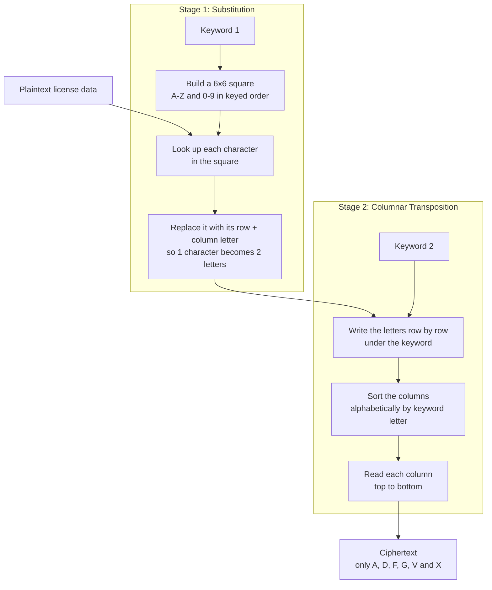

::blog-alert{type="warning" title="Legal Disclaimer"}

This article is published for **educational and research purposes only**. The software discussed here was obtained from files that were publicly accessible on the vendor's website, and all analysis was performed on a local copy. No live systems, facilities, or real user data were accessed.

Nothing in this article is intended to encourage or assist unauthorized access to any computer system. Do not use this information against systems you do not own or have explicit permission to test. I am not affiliated with JailATM, Lockdown, TechFriend, or any related company, and all trademarks belong to their respective owners. This is not legal advice.

tl;dr: **Please, don't be an idiot.**

::

This article was inspired by [Vio's research](https://vio.gay/posts/prisoner-commercialization.html), which covers some pretty.. well.. concerning practices in prison software. I **highly recommend** reading it first for context. My goal here was to go deeper into Lockdown itself and get a local copy running.

**This will not be a comprehensive report or a guide on how to use the software!!** JailATM (Lockdown) is a large program containing many features and components, and to cover them all would be beyond the scope of this article. Instead, the focus will be on specific security aspects and vulnerabilities discovered during the analysis.

Anyways.. grab some popcorn.. relax.. and let's dive into the world of prison software :)

## Background

The more I read, the more I wanted to see what made JailATM tick. How was it built? What would it take to run it myself? And what might I find once I could actually poke around?

Using her research as a starting point, I was able to find the same directory listing on TechFriend's site, which provided a lot of files, including various support EXEs, versions, updaters, and much, much more.


Well.. this poses two problems:

1. The sheer VOLUME of files makes it difficult to determine which ones are relevant for analysis..

2. I don't really want to download all of these files by hand.. that would be extremely time-consuming and inefficient.

At least for #2, I was able to quickly whip a tool in Go to parse the listing and download all files for later analysis. This significantly reduced the manual effort required and allowed me to focus on examining the relevant files for security issues.


#2 solved.. but which of these files were actually worth looking at?

I know that a lot of people these days do not like AI assistance in research work as it tends to "taint" the originality of the findings. However, AI was **made** to help with a task that is exactly what I needed: sifting through large amounts of data, identifying patterns, and prioritizing files for further inspection. By leveraging AI, I could efficiently narrow down the list of files to those most likely to contain security-relevant information, without compromising the integrity of my research.

All other research steps were done by me, with my own two hands, a bit of weed, and some tools (dnSpyEx, mainly). I want to make it clear that AI was only used as an assistant for organizing and prioritizing files, and all actual analysis and findings were conducted personally by me.

That narrowed things down enough to start setting up what I aptly call the "bonking environment" (get it? I'm so funny).

## Setting up Bonking Environment

On my first look through the files, I found references to SQL Server 2022. I decided to grab the Windows Server 2022 ISO, fire up Hyper-V, and set up a virtual machine to create a controlled environment for my analysis.

As a precaution, this machine did not have network access, and files were transferred using the `Copy-VMFile` PowerShell cmdlet.

Now.. with the files in place.. let's see what we got.


I organized the extracted files into two folders based on AI's prioritization: One folder for a "ServerCD" and one for a "ClientCD". These presumably serve different purposes and have different setup steps when under a non-virtualized environment.. However, both "main" HTA (HTML Application) files seemed to do the **same** thing, with only one or two differences. Of course, the client install here is likely off the table because we need to emulate hardware and well.. I'd rather blow my brains out than emulate hardware for an ATM/Kiosk.

So, ServerCD it is! Let's open it.


Well.. that was somewhat underwhelming. It looks to me that the HTA is the main entry point, and all other files here are just EXEs called by it to install it, nothing too exciting at first glance. Let's run the HTA and see what happens.


Neat, looks like this is what we need to install. Side note, man, these versions of .NET and SQL Server are ancient! Way to bring me back to the early 2000s... (foreshadowing)

Anyways, after installing all of those, a new app in our start menu appeared, Lockdown, which I will be calling JailATM from now on. Let's fire it up and see what we're dealing with.


Woop! We got a config screen. Let's just accept the defaults for now and see what happens.


Well, crap. Looks like we hit a roadblock here with the activation key requirement. Without it, we can't proceed any further in the application. That's not good! Now it's time for..

## Bonking: Getting Around the Activation Key

There's two ways to do this. One is try to figure out how activation works, and simply make the checks return true, or, create a key generator that produces valid activation keys. Both approaches have their pros and cons, but I'm not a pansy, so we'll be going after the key generator route.

First, I opened the application in dnSpyEx to see what we were dealing with. Conveniently, TechFriends follows a naming scheme, and I was able to find the displayed form, called `frmLicenseKey`. Let's take a look at the "Save" button handler and see whats going on

```csharp
private void cmdSave_Click(object sender, EventArgs e)
{
    global::libLockdown.License license = new global::libLockdown.License();
    int licenseNum;
    bool licenseOk = license.ValidLicense(this.txtLicenseKey.Text, ref licenseNum);

    if (licenseOk)
    {
        Globals.GlobalSettings.SiteOptions.SiteLicense = this.txtLicenseKey.Text;
    }

    base.Close();
}

```

The save button calls `License.ValidLicense()` and stores the key if it passes. That's our next stop.

```csharp
public bool ValidLicense(string licenseKey, ref int daysRemaining)
{

    EncryptASCII encryption = new EncryptASCII();
    bool isValid = false;
    
    checked
    {
        try
        {

            string decodedLicense = encryption.DecodeADFGVX(
                licenseKey,
                Globals.GlobalSettings.SiteOptions.SiteGUID + "AMOS",
                "HAGGAI"
            ).Trim();

            if (decodedLicense.Length < 5)
                throw new Exception("Invalid License Format");

            string licenseSiteGUID =
                decodedLicense.Substring(0, 1) +
                decodedLicense.Substring(2, 1) +
                decodedLicense.Substring(4, 1);

            string currentSiteGUID =
                Globals.GlobalSettings.SiteOptions.SiteGUID.ToUpper();

            if (licenseSiteGUID.ToUpper() != currentSiteGUID.Substring(0, 3))
                throw new Exception("Invalid License Format");

            bool isLegacyLicense = licenseKey.Length == 10;
            DateTime expirationDate;

            if (isLegacyLicense)
            {

                int yearOffset = decodedLicense[1] - 'A';
                int expirationMonth = decodedLicense[3] - 'A';
                int expirationYear = yearOffset + 2000;
                
                if (expirationYear > DateTime.Today.Year + 2 ||
                    expirationYear < DateTime.Today.Year)
                    throw new Exception("Invalid License Format");

                if (expirationMonth < 1 || expirationMonth > 12)
                    throw new Exception("Invalid License Format");

                if (yearOffset < 10)
                {
                    expirationDate = Conversions.ToDate(
                        expirationMonth + "/1/200" + yearOffset
                    );
                }
                else
                {
                    expirationDate = Conversions.ToDate(
                        expirationMonth + "/1/20" + yearOffset
                    );
                }
            }
            else
            {

                int yearThousands = decodedLicense[1] - 'A';
                int yearHundreds = decodedLicense[5] - 'A';
                int yearTens = decodedLicense[6] - 'A';
                int yearOnes = decodedLicense[7] - 'A';
                int expirationYear =
                    yearThousands * 1000 +
                    yearHundreds * 100 +
                    yearTens * 10 +
                    yearOnes;

                int expirationMonth = decodedLicense[3] - 'A';
                if (expirationYear < DateTime.Today.Year ||
                    expirationYear > DateTime.Today.Year + 2)
                    throw new Exception("Invalid License Format");

                if (expirationMonth < 1 || expirationMonth > 12)
                    throw new Exception("Invalid License Format");

                expirationDate = new DateTime(
                    expirationYear,
                    expirationMonth,
                    1
                );
            }

            if (DateTime.Today < expirationDate)
            {
                isValid = true;
                daysRemaining = (int)DateAndTime.DateDiff(
                    DateInterval.Day,
                    DateTime.Today,
                    expirationDate,
                    FirstDayOfWeek.Sunday,
                    FirstWeekOfYear.Jan1

                );

            }
            else
            {

                isValid = false;
                daysRemaining = 0;
                License license = new License();
                Globals.GlobalSettings.SiteOptions.SiteGUID =
                    license.GenerateSiteGUID();
            }
        }

        catch (Exception)
        {

            isValid = false;
        }

        return isValid;
    }

}

```

Okay, a lot to unpack.

First, the supplied license is decoded using the site's GUID and two hardcoded cipher parameters (lmao, seriously?). It then extracts three characters from the decoded license and checks whether they match the current site's identifier.

If this passes, it determines whether the license uses the legacy or newer format, extracts the expiration date, and verifies that the date falls within the allowed range. If the license is still valid, the method returns `true` and updates `daysRemaining`. The formats really don't matter here, as the same data is ultimately used to calculate the expiration date and validate the license.

One particularly interesting detail is what happens when a license expires. Rather than simply rejecting it, the application generates a new Site GUID, effectively invalidating the existing license for that installation. This means that even if a user has a valid license, once it expires, they must obtain a new license tied to the newly generated Site GUID, enforcing strict control over license validity. Perhaps TechFriends wanted to ensure that expired licenses could not be reused or transferred, maintaining tight control over software distribution and usage (surprising no one).

That explains validation. But how are these keys encoded in the first place?

### Understanding License Encoding/Encryption

The `EncryptASCII` class gives us a pretty big clue with its `DecodeADFGVX()` method. Well, way to give away your encryption scheme in the function name, huh? I'll spare you the full implementation here; it's a long one.

The ADFGVX cipher is a classical encryption technique that combines a substitution cipher with a transposition cipher. The name comes from the six letters used in the cipher's square: A, D, F, G, V, and X. This gives us a strong hint about how the license keys are being encoded and why the function is named as such.

Fun fact, this cipher was originally used by the German Army during World War I and later adapted for use in World War II. Its combination of substitution and transposition makes it relatively secure for its time, and it explains why the developers of Lockdown chose it for encoding license keys.

The cipher works in two stages. First, it uses a 6×6 substitution square to convert each character into a pair of letters. It then runs the result through a columnar transposition cipher, rearranging the characters based on a supplied keyword.



Decoding (`DecodeADFGVX`) is just the same steps run in reverse: undo the transposition with the second keyword, then turn each letter pair back into a character using the square.

Lockdown uses the same algorithm for both site request codes and activation keys, but with different parameters: JOSHUA and NAHUM for request codes; the site GUID followed by AMOS, plus HAGGAI, for activation keys. I wonder who these people are, and if they are going to get in trouble for hardcoding their names as an encryption key... oh man these companies really have no shame, do they?

Because both the encryption algorithm and its key parameters are present in the application's .NET assemblies, we have enough information to study and reproduce the encoding process without needing access to the original license-issuing software.

### Creating a key generator

For me, my go-to for this was Python. The first thing I did was mirror the functions from the .NET implementation, creating Python equivalents of the substitution square and columnar transposition steps. This gave me a way to experiment with the algorithm without having to constantly go back into the decompiled application.

Once I had the encoding and decoding functions working, I wanted to make sure they actually matched what Lockdown was doing. I grabbed a request code directly from the application, in my case, `DVFVGX`, and ran it through my Python implementation. It decoded to `MRE`, which was the three-character Site GUID. Encoding `MRE` again produced the exact same request code, so things were looking promising.

From there, I moved on to generating actual license keys. Since we'd already figured out how `ValidLicense()` extracts the Site GUID and expiration date, it was mostly a matter of constructing the expected plaintext and passing it through the same encryption process, this time using the license-specific keys.

I eventually wrapped everything into a simple terminal script. Rather than having a bunch of commands or options, it just asks for the request code, decodes the Site GUID, and generates a license with a predefined expiration date. This code is available in a [paste](https://paste.hep.gg/GpgPZaE/raw)

My Python validator accepted the generated key, but would Lockdown itself? I entered the request code, pasted the response, and.. success! The application accepted it :)

## Bonking: Getting in the App

With activation out of the way, Lockdown greeted me with.. a login prompt.

Great. Another problem to solve!

At this point, I had no idea what the default credentials were, or if there even were any. Rather than sit there guessing usernames and passwords, I figured it would be easier to take a look at how Lockdown actually handles authentication.

### Figuring Out Authentication

Back into dnSpyEx we go!

I started by looking at `frmLogin`, which, as the name suggests, handles the application's login screen. Looking through the code revealed that Lockdown supports several authentication methods, including standard username/password authentication, LDAP, and Windows SSO.

For our purposes, we're interested in standard authentication, since this is a fresh installation without an Active Directory environment.

Following the login process eventually led me to `DatabaseInitializer.LoginUser()`, which contains this little snippet:

```csharp
bool isValidUser =
    user.IsActive &&
    user.IsPasswordMatch(password.Trim().ToUpper()) &&
    !user.IsGroupTemplate;
```

Pretty standard: the account has to be active, not a group template, and have a matching password.

What caught my attention was `IsPasswordMatch()`. Following that method brought me to another class called `EncryptHash`, which handles password hashing.

And oh boy.. we're using SHA-1.

Specifically, Lockdown takes the password, converts it to uppercase, hashes it with SHA-1, appends a random four-byte salt, and then hashes the result again using SHA-1. The final hash and salt are stored together as a 24-byte binary value.

```text
SHA1(SHA1(UPPERCASE(password)) + salt) + salts
```

It's worth mentioning that this is not a modern password hashing scheme. SHA-1 is incredibly fast, and running it twice doesn't suddenly make it suitable for password storage. The four-byte salt is also quite small by today's standards.

But hey, at least they weren't storing passwords in plaintext!

### Poking Around the Database

`DatabaseInitializer` also pointed me toward SQL Server, with a separate database for site configuration and individual site databases. Time to open SQL Server Management Studio (SSMS).

I found three databases:

\- `TFSites` - Stores site and station configuration.

\- `TFSiteDB1` - The main application database.

\- `TFSiteDB2` - The training database.

Querying the `Sites` table confirmed that the application had created two active sites, one for normal operation and another for training.

Next, I took a look at the `Users` table. Since this was a fresh installation, there wasn't much there. Just two accounts:

```text
UserID    UserName
1         ADMIN
2         LOCKDOWN
```

Looking a little closer, `ADMIN` had web-based two-factor authentication enabled, while `LOCKDOWN` was marked as an internal account.

Neither was particularly useful for what I wanted to do, so I decided to create a dedicated account for testing.

### Creating Our Own User

I didn't want to start inserting values blindly, so I checked the schema and compared it with the decompiled `User` class.

The `Users` table contains the usual stuff, such as usernames, password hashes, active status, and account information. However, two fields stood out:

```text
SecurityToken1    bigint
SecurityToken2    bigint
```

Despite their names, these weren't authentication tokens. The `User` class revealed that they're bitmasks for permissions.

Each bit represents a particular permission, such as accessing inventory, managing users, or performing financial operations.

The application also has a method called `SetSecurity()`, which handles modifying these permissions. Interestingly, granting the `IsAdmin` permission causes it to enable all the permission bits.

Armed with the schema and hashing logic, I created a test administrator directly in my isolated SQL Server database.

Here's the SQL query I used:

```sql
USE TFSiteDB1;

GO
SET XACT_ABORT ON;
DECLARE @Username VARCHAR(20) = 'TESTADMIN';
DECLARE @Password VARCHAR(50) = 'admin';
DECLARE @Salt VARBINARY(4) = CRYPT_GEN_RANDOM(4);
DECLARE @NormalizedPassword VARCHAR(50) =
    UPPER(LTRIM(RTRIM(@Password)));
DECLARE @FirstHash VARBINARY(20) =
    HASHBYTES(
        'SHA1',
        CONVERT(VARBINARY(MAX), @NormalizedPassword)
    );
DECLARE @FinalHash VARBINARY(20) =
    HASHBYTES('SHA1', @FirstHash + @Salt);

DECLARE @StoredPassword BINARY(24) =
    CONVERT(BINARY(24), @FinalHash + @Salt);

BEGIN TRANSACTION;

IF EXISTS (
    SELECT 1 FROM dbo.Users
    WHERE RTRIM(UserName) = @Username
)

BEGIN
    ROLLBACK TRANSACTION;
    THROW 50001, 'Test username already exists.', 1;
END;

INSERT INTO dbo.Users (
    FirstName,
    LastName,
    UserName,
    Password,
    IsActive,
    IsAdmin,
    SecurityToken1,
    SecurityToken2,
    DefaultFacilityID,
    AccountType,
    Web2FA
)
VALUES (
    'Test',
    'Administrator',
    @Username,
    @StoredPassword,
    1,
    1,
    -1,
    -1,
    1,
    0,
    0
);

COMMIT TRANSACTION;
```

The query generates a random four-byte salt, reproduces Lockdown's password hashing algorithm, and inserts a new user with the required account information.

For the permissions, both `SecurityToken1` and `SecurityToken2` are set to `-1`. Since these are signed 64-bit integers, `-1` represents all 64 bits being enabled, effectively granting every permission represented by those bitmasks.

I also assigned the account to Facility ID `1`, which was already present in our fresh installation.

Now for the moment of truth..

I fired up Lockdown again, selected the main database, and entered our new credentials.

And.. **IT WORKED!**


We were finally logged into Lockdown, using our custom administrator account on the **main database**, not the training environment. This does matter a tad, as the login process for the main database is the one that actually enforces the password hash verification, confirming that our SQL hashing approach works correctly, while training environments might not perform the same checks and just login with a hardcoded account (training:training).

Now.. what can we actually do in here?

## Bonking: Basic Exploration

Lockdown has a LOT of modules, and covering them all would turn this into a small novel. Here are a couple of things that stood out during my first look around.

### A Blast From the Past

One of the first things that caught my attention was the help system.

Apparently, the developers were pretty big fans of Adobe Flash, because the application's help videos are `.swf` files. Yes, Flash. The same Flash that Adobe officially killed off back in 2020.

Talk about a throwback!

Since Flash is no longer supported by modern browsers, you'll need something like [Ruffle](https://ruffle.rs/) to play these files nowadays. Thankfully, Ruffle does a pretty decent job of bringing old Flash content back to life.

I found a few of the original help resources that are still accessible:

\- [Main Menu](https://www.myTechFriends.com/help/)

\- [Resident Help](https://www.myTechFriends.com/help/residentDemo.html)

\- [Check Writing](https://www.myTechFriends.com/help/CheckWriting.swf)

They're an interesting little time capsule of how people were expected to learn the software.

### Creating Our First Resident

After clicking around for a while, I eventually figured out how to create a resident in the system.

For those unfamiliar, residents are essentially the people being managed by the software. Their records are used throughout various parts of the application, including its financial and account-management features.

Of course, I needed someone to test this with.

And who better than Vio, the very person whose research sent me down this entire rabbit hole in the first place?

So, naturally, Vio became our first test resident. Congratulations! :3


Jokes aside, seeing a resident record show up in our isolated installation was pretty satisfying. There's still plenty to examine around accounts, transactions, and financial operations, but I think we've done enough bonking for one day.

## Conclusion

Well.. that was quite the rabbit hole. What started with a directory listing ended with a working local installation and a few surprises along the way.

The licensing, password hashing, and permission systems gave me plenty to think about, and I've barely scratched the surface. There's probably another whole article hiding in the financial modules alone.

For now, I got what I came for: a safe place to poke around without touching any live systems. And a reminder that sometimes the best way to understand a program is to take it apart and see what happens.

Anyways, until next time :)

^Sticks
